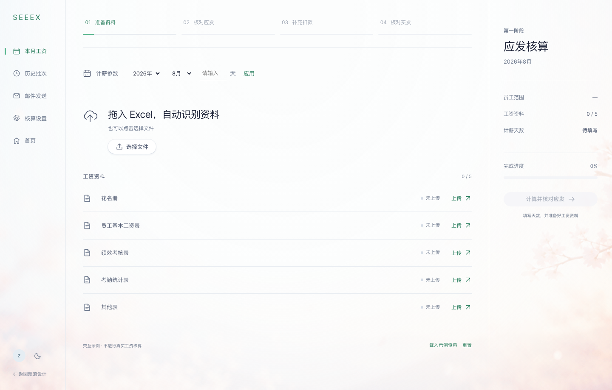

# 规范设计

一套以 **连续画布、轻量控件、樱花背景** 为核心的界面规范。包含可交互组件库、完整薪资示例、设计变量、本地字体与素材、中文接入文档和研究来源。

视觉方向：用户已通过的第二版连续画布；背景采用用户指定的 Fernand 樱花原图。



## 打开预览

需要 Node.js 18 或更新版本。运行页面不需要安装依赖。

```sh
cd 设计规范
npm start
```

打开 `http://127.0.0.1:3091` 查看组件库，打开 `http://127.0.0.1:3091/示例/payroll.html` 查看完整页面。其他静态服务器也可使用；也可以直接作为静态目录托管。ES modules 需要 HTTP 服务，不建议双击 HTML 使用 `file://`。

## 目录

```text
设计规范/
├── index.html                 可操作的组件与画布展示页
├── 设计令牌/                    JSON 变量与生成后的 CSS
├── 样式/                    基础、组件、画布、动效与页面组合
├── 组件/                独立交互控制器、日期字段、图标与小组件
├── 示例/                  完整薪资工作台示例
├── 设计资产/
│   ├── 背景图/           指定樱花原图
│   ├── 字体/                 本地 Inter 及 OFL 许可
│   ├── 图标/                 图标入口
│   └── manifest.json          来源、许可状态、大小和 SHA-256
├── 说明文档/                      中文规范与接入说明
├── 研究资料/                  原站测量、交互记录、证据图与通过的设计稿
├── 预览图/                  实际浏览器渲染截图
├── 自动化测试/                     交互与响应式回归检查
└── 构建脚本/                   静态服务、变量生成与完整性检查
```

## 内容入口

- [设计原则与尺寸规则](说明文档/design-rules.md)
- [组件清单、交互和状态](说明文档/components.md)
- [接入、主题与组件 API](说明文档/usage.md)
- [Fernand 深入研究](说明文档/research.md)
- [素材来源与许可范围](说明文档/assets.md)
- [检查记录与复现方式](说明文档/validation.md)

## 核心约定

1. 页面只有一层主要工作画布。列表、表单、步骤直接在画布上排版。
2. 主要用留白与细线分区；小卡片用于独立数据对象；明显阴影留给临时浮层。
3. 蓝色是 Fernand 的参考强调色，薄荷绿是此次应用的适配。标题与正文以深蓝灰为主。
4. 樱花展示画布保留原图；工作画布通过 CSS 渐隐层降低内容区干扰。原图没有裁改或重新生成。
5. 进度只由完成条件推进；查看某一步不会让它变成已完成。

## 可交互示例

组件页包括按钮、表单校验、搜索过滤、选择控件、状态、表格、页签、展开区域、步骤进度、菜单、对话框、抽屉、提示、命令菜单和樱花小组件预览。

薪资示例从空资料开始。填写天数并应用，再点击「载入示例资料」可体验完整四步流程。核对每位示例员工后才能继续。选择真实 Excel 只展示文件名，**不解析、不上传、不进行工资计算**，也不会把未解析文件当作校验成功。刷新或重置会清空业务示例状态。

## 开发与检查

```sh
npm run tokens   # 修改 设计令牌/tokens.json 后生成 CSS
npm run check    # 本地链接、资源、语法、变量与资源哈希
```

交互测试使用 Playwright；安装和运行方法见 [检查记录](说明文档/validation.md)。运行网站本身没有 npm 依赖，也没有第三方网络请求。

## 后续 GitHub

目录已整理为可独立管理的静态项目，包含 `.gitignore`、许可与素材来源。本次只保存本地目录，没有初始化远程仓库或上传。后续确认仓库后可整目录提交；GitHub Pages 可直接托管根目录，无需构建。背景图的原始来源与未声明开放许可的状态保留在 [素材说明](说明文档/assets.md)，不要将第三方素材并入代码的 MIT 授权声明。
